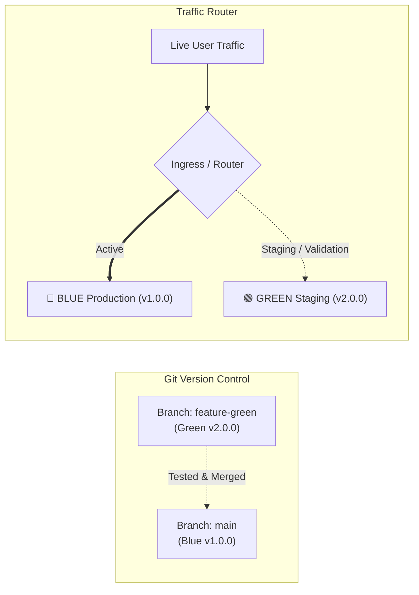

# 🚀 TrafficSwitch: Zero-Downtime Blue-Green Release Simulation

[](#)
[](#)
[](#)
[](#)
[](#)

> An interactive visual simulation demonstrating the mechanics of **Zero-Downtime Blue-Green Deployments**, **Semantic Versioning (SemVer)**, and **Git Branch Lifecycles** across local and remote environments.

---

## 📌 Problem Statement

In mission-critical enterprise environments, deploying new features cannot involve maintenance windows or user-facing downtime (`502 Bad Gateway`). 
This project models an immutable zero-downtime release pipeline where:
* **Blue (v1.0.0):** Active production environment serving 100% of live traffic.
* **Green (v2.0.0):** Isolated staging environment hosting the new feature release.
* **Traffic Switch:** Instant version cutover without taking down the service.

---

## 🎨 Visual Architecture



---

## 🛠️ Key Engineering Takeaways Demonstrated

### 1. Decoupled Branch Lifecycle (Local vs Remote)
Demonstrates the fundamental behavior of distributed version control systems:
* `git branch -d <branch>` removes the branch reference **only on the local host**.
* `git push origin --delete <branch>` explicitly instructs the remote repository (`origin`) to purge the remote branch reference.
* `git fetch --prune` synchronizes and purges stale tracking references across distributed teams.

### 2. Semantic Versioning (SemVer)
Releases are permanently marked with immutable annotated Git tags:
* `v1.0.0` — Initial production baseline (Blue).
* `v2.0.0` — Major feature release with instant checkout (Green).
* `v2.0.1` — Hotfix patch for CSS button alignment.

---

## 💻 Quick Start & Local Execution

1. **Clone the repository:**
   ```bash
   git clone https://github.com/jarvis-ctrl69/blue-green.git
   cd blue-green
   ```

2. **Open the live application:**
   * Open `index.html` in any web browser.

3. **Simulate Branch Switching:**
   ```bash
   # Switch to the historical v1.0.0 Blue release
   git checkout v1.0.0

   # Switch to current production Green
   git checkout main
   ```

---

## 👤 Author

* **Harsha** — Aspiring DevOps & Cloud Engineer
* **GitHub:** [@jarvis-ctrl69](https://github.com/jarvis-ctrl69)
